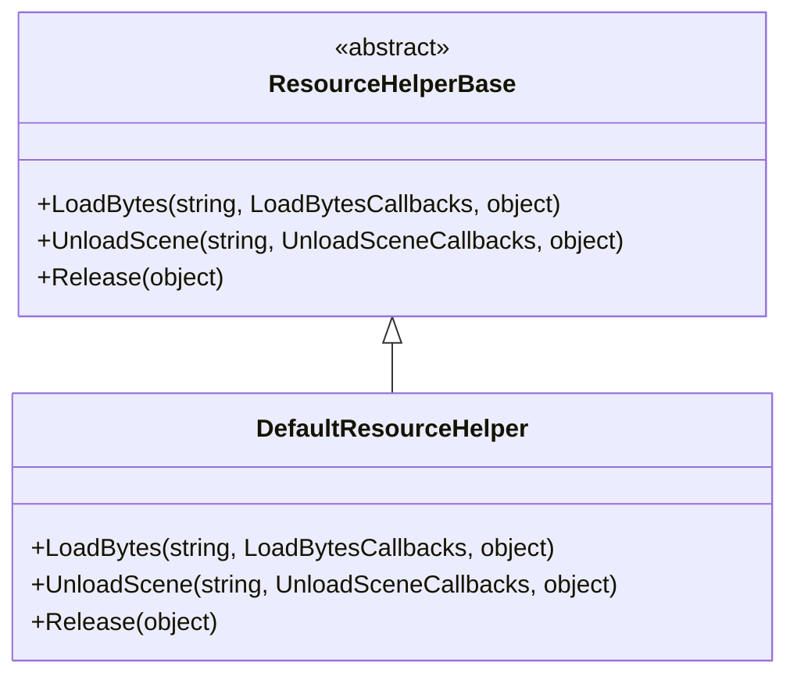
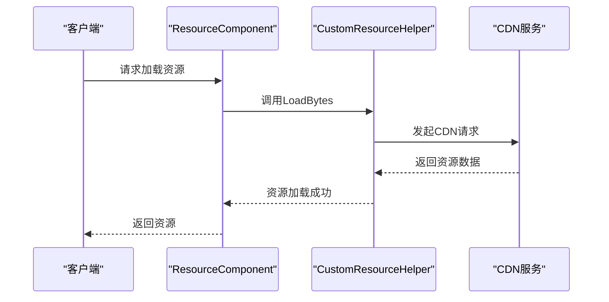
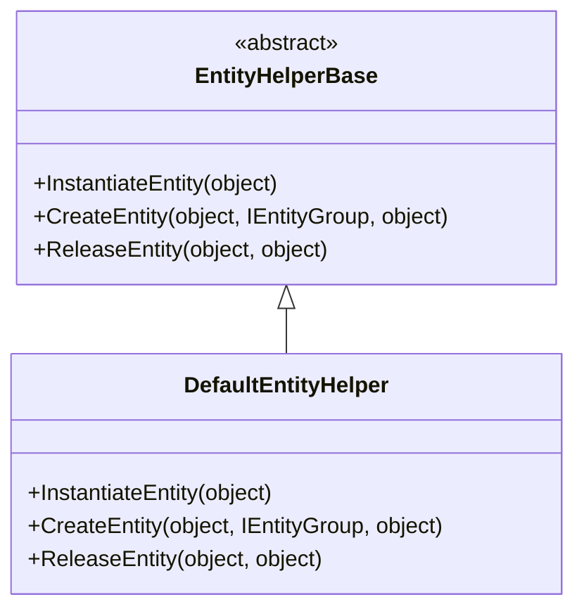
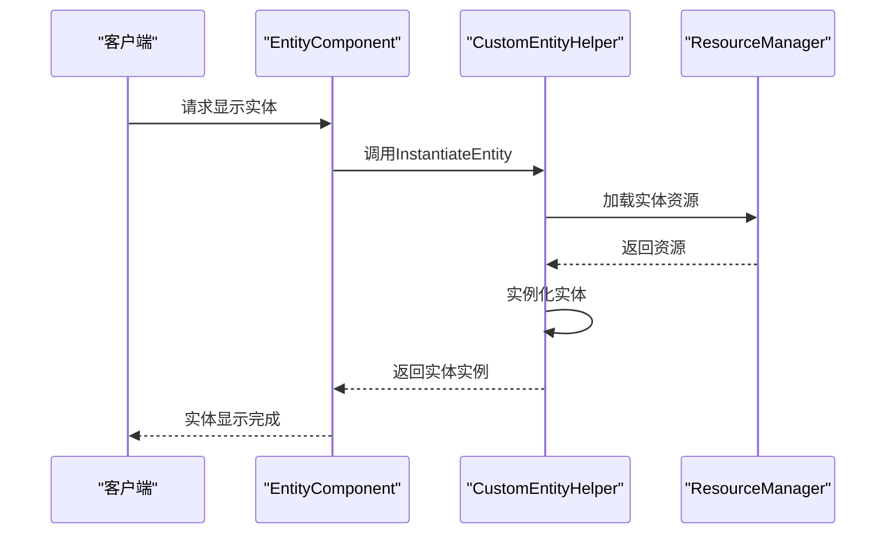
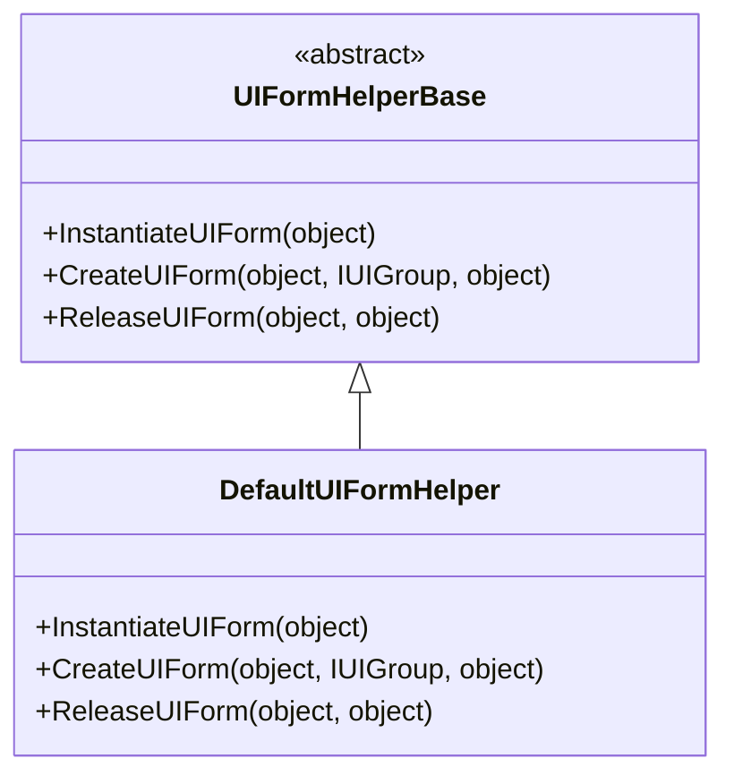
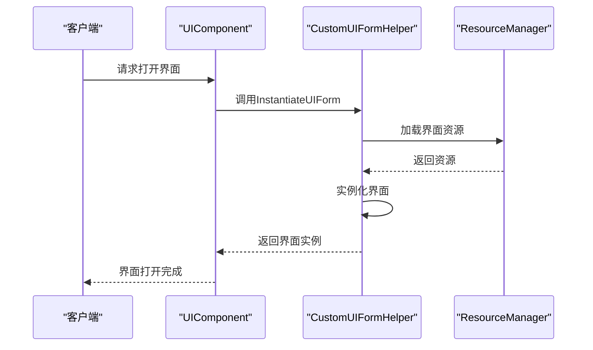
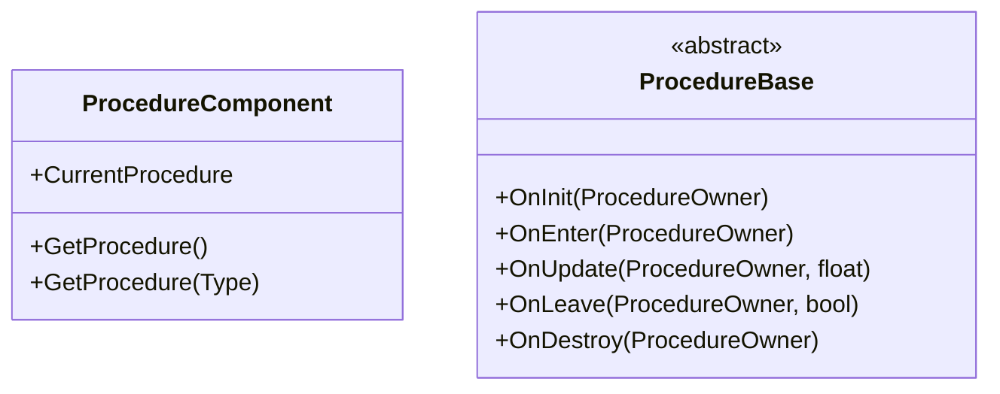
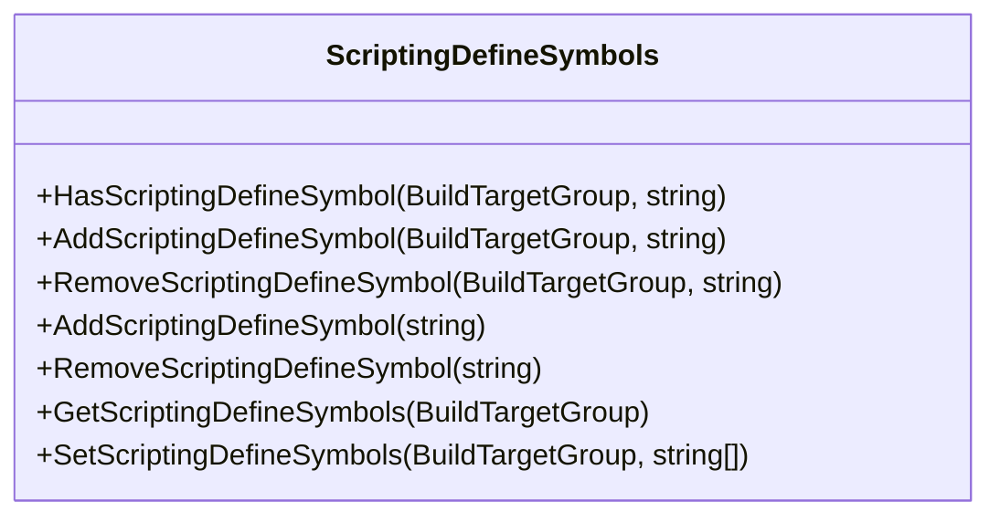

# 配置与扩展

<cite>
**本文档引用的文件**  
- [DefaultResourceHelper.cs](file://Scripts/Runtime/Resource/DefaultResourceHelper.cs)
- [ResourceHelperBase.cs](file://Scripts/Runtime/Resource/ResourceHelperBase.cs)
- [DefaultEntityHelper.cs](file://Scripts/Runtime/Entity/DefaultEntityHelper.cs)
- [EntityHelperBase.cs](file://Scripts/Runtime/Entity/EntityHelperBase.cs)
- [DefaultUIFormHelper.cs](file://Scripts/Runtime/UI/DefaultUIFormHelper.cs)
- [UIFormHelperBase.cs](file://Scripts/Runtime/UI/UIFormHelperBase.cs)
- [ResourceComponent.cs](file://Scripts/Runtime/Resource/ResourceComponent.cs)
- [EntityComponent.cs](file://Scripts/Runtime/Entity/EntityComponent.cs)
- [UIComponent.cs](file://Scripts/Runtime/UI/UIComponent.cs)
- [ScriptingDefineSymbols.cs](file://Scripts/Editor/Misc/ScriptingDefineSymbols.cs)
- [link.xml](file://Libraries/link.xml)
</cite>

## 目录
1. [引言](#引言)
2. [框架扩展机制概述](#框架扩展机制概述)
3. [资源加载扩展](#资源加载扩展)
4. [实体管理扩展](#实体管理扩展)
5. [UI系统扩展](#ui系统扩展)
6. [流程控制扩展](#流程控制扩展)
7. [配置文件与编译符号](#配置文件与编译符号)
8. [最佳实践与注意事项](#最佳实践与注意事项)
9. [总结](#总结)

## 引言
本文档旨在深入解析UnityGameFramework框架的配置与扩展机制。框架通过策略模式提供了一系列可扩展点，允许开发者在不修改核心代码的前提下，定制资源加载、实体管理、UI系统等关键模块的行为。本文将详细说明如何通过继承基类来实现自定义逻辑，并介绍相关配置文件的使用方法。

## 架构扩展机制概述

UnityGameFramework采用策略模式（Strategy Pattern）实现模块化扩展，其核心思想是将可变的行为抽象为接口或抽象基类，允许用户通过继承和重写来替换默认实现。这种设计模式使得框架既保持了核心逻辑的稳定性，又具备了高度的可定制性。

框架中的主要扩展点包括：
- **ResourceHelperBase**：用于自定义资源加载和释放逻辑
- **EntityHelperBase**：用于控制实体的实例化和销毁过程
- **UIFormHelperBase**：用于实现自定义的UI加载和卸载规则
- **ProcedureBase**：用于添加新的游戏流程
- **Packet**：用于集成自定义网络协议

这些扩展点通过组件系统进行管理，开发者可以在编辑器中指定自定义的Helper类，框架会在运行时动态创建并使用这些自定义实现。

**Section sources**
- [ResourceHelperBase.cs](file://Scripts/Runtime/Resource/ResourceHelperBase.cs#L15-L38)
- [EntityHelperBase.cs](file://Scripts/Runtime/Entity/EntityHelperBase.cs#L15-L39)
- [UIFormHelperBase.cs](file://Scripts/Runtime/UI/UIFormHelperBase.cs#L15-L39)

## 资源加载扩展

### 资源助手基类

`ResourceHelperBase`是资源加载的抽象基类，定义了三个核心方法：
- `LoadBytes`：从指定文件路径加载数据流
- `UnloadScene`：卸载场景
- `Release`：释放资源



**Diagram sources**
- [ResourceHelperBase.cs](file://Scripts/Runtime/Resource/ResourceHelperBase.cs#L15-L38)
- [DefaultResourceHelper.cs](file://Scripts/Runtime/Resource/DefaultResourceHelper.cs#L21-L181)

### 自定义资源加载器

要创建自定义的资源加载器，需要继承`DefaultResourceHelper`并重写相关方法。例如，可以实现一个集成第三方CDN的资源加载器：



**Diagram sources**
- [ResourceComponent.cs](file://Scripts/Runtime/Resource/ResourceComponent.cs#L560-L655)
- [DefaultResourceHelper.cs](file://Scripts/Runtime/Resource/DefaultResourceHelper.cs#L29-L32)

### 扩展实现示例

以下是一个自定义资源加载器的基本结构：

```csharp
public class CustomResourceHelper : DefaultResourceHelper
{
    public override void LoadBytes(string fileUri, LoadBytesCallbacks loadBytesCallbacks, object userData)
    {
        // 自定义资源加载逻辑，如集成CDN、特殊缓存策略等
        // ...
    }
    
    public override void Release(object objectToRelease)
    {
        // 自定义资源释放逻辑
        // ...
    }
}
```

在编辑器中，可以通过`ResourceComponent`的`m_ResourceHelperTypeName`字段指定自定义Helper类的类型名称，框架会通过反射创建实例并使用。

**Section sources**
- [DefaultResourceHelper.cs](file://Scripts/Runtime/Resource/DefaultResourceHelper.cs#L21-L181)
- [ResourceComponent.cs](file://Scripts/Runtime/Resource/ResourceComponent.cs#L560-L655)

## 实体管理扩展

### 实体助手基类

`EntityHelperBase`是实体管理的抽象基类，定义了三个核心方法：
- `InstantiateEntity`：实例化实体
- `CreateEntity`：创建实体
- `ReleaseEntity`：释放实体



**Diagram sources**
- [EntityHelperBase.cs](file://Scripts/Runtime/Entity/EntityHelperBase.cs#L15-L39)
- [DefaultEntityHelper.cs](file://Scripts/Runtime/Entity/DefaultEntityHelper.cs#L15-L71)

### 自定义实体管理器

要创建自定义的实体管理器，需要继承`DefaultEntityHelper`并重写相关方法。例如，可以实现一个带有特殊初始化逻辑的实体管理器：



**Diagram sources**
- [EntityComponent.cs](file://Scripts/Runtime/Entity/EntityComponent.cs#L107-L163)
- [DefaultEntityHelper.cs](file://Scripts/Runtime/Entity/DefaultEntityHelper.cs#L24-L27)

### 扩展实现示例

以下是一个自定义实体管理器的基本结构：

```csharp
public class CustomEntityHelper : DefaultEntityHelper
{
    public override object InstantiateEntity(object entityAsset)
    {
        // 自定义实体实例化逻辑
        var instance = base.InstantiateEntity(entityAsset);
        // 添加自定义初始化逻辑
        return instance;
    }
    
    public override void ReleaseEntity(object entityAsset, object entityInstance)
    {
        // 自定义实体释放逻辑
        // ...
        base.ReleaseEntity(entityAsset, entityInstance);
    }
}
```

在编辑器中，可以通过`EntityComponent`的`m_EntityHelperTypeName`字段指定自定义Helper类的类型名称。

**Section sources**
- [DefaultEntityHelper.cs](file://Scripts/Runtime/Entity/DefaultEntityHelper.cs#L15-L71)
- [EntityComponent.cs](file://Scripts/Runtime/Entity/EntityComponent.cs#L107-L163)

## UI系统扩展

### UI助手基类

`UIFormHelperBase`是UI系统管理的抽象基类，定义了三个核心方法：
- `InstantiateUIForm`：实例化界面
- `CreateUIForm`：创建界面
- `ReleaseUIForm`：释放界面



**Diagram sources**
- [UIFormHelperBase.cs](file://Scripts/Runtime/UI/UIFormHelperBase.cs#L15-L39)
- [DefaultUIFormHelper.cs](file://Scripts/Runtime/UI/DefaultUIFormHelper.cs#L15-L72)

### 自定义UI管理器

要创建自定义的UI管理器，需要继承`DefaultUIFormHelper`并重写相关方法。例如，可以实现一个带有特殊加载规则的UI管理器：



**Diagram sources**
- [UIComponent.cs](file://Scripts/Runtime/UI/UIComponent.cs#L183-L245)
- [DefaultUIFormHelper.cs](file://Scripts/Runtime/UI/DefaultUIFormHelper.cs#L24-L27)

### 扩展实现示例

以下是一个自定义UI管理器的基本结构：

```csharp
public class CustomUIFormHelper : DefaultUIFormHelper
{
    public override object InstantiateUIForm(object uiFormAsset)
    {
        // 自定义界面实例化逻辑
        var instance = base.InstantiateUIForm(uiFormAsset);
        // 添加自定义初始化逻辑
        return instance;
    }
    
    public override void ReleaseUIForm(object uiFormAsset, object uiFormInstance)
    {
        // 自定义界面释放逻辑
        // ...
        base.ReleaseUIForm(uiFormAsset, uiFormInstance);
    }
}
```

在编辑器中，可以通过`UIComponent`的`m_UIFormHelperTypeName`字段指定自定义Helper类的类型名称。

**Section sources**
- [DefaultUIFormHelper.cs](file://Scripts/Runtime/UI/DefaultUIFormHelper.cs#L15-L72)
- [UIComponent.cs](file://Scripts/Runtime/UI/UIComponent.cs#L183-L245)

## 流程控制扩展

### 流程组件

`ProcedureComponent`负责管理游戏的流程控制，通过`ProcedureManager`管理不同的流程状态。开发者可以通过继承`ProcedureBase`来添加新的游戏流程。



**Diagram sources**
- [ProcedureComponent.cs](file://Scripts/Runtime/Procedure/ProcedureComponent.cs#L35-L145)
- [ProcedureBase](file://Scripts/Runtime/Procedure/ProcedureBase.cs)

### 自定义流程实现

要添加新的游戏流程，需要创建一个继承`ProcedureBase`的类，并实现相应的生命周期方法：

```csharp
public class CustomProcedure : ProcedureBase
{
    protected override void OnInit(ProcedureOwner procedureOwner)
    {
        // 流程初始化逻辑
    }
    
    protected override void OnEnter(ProcedureOwner procedureOwner)
    {
        // 进入流程逻辑
    }
    
    protected override void OnUpdate(ProcedureOwner procedureOwner, float elapseSeconds)
    {
        // 流程更新逻辑
    }
    
    protected override void OnLeave(ProcedureOwner procedureOwner, bool isShutdown)
    {
        // 离开流程逻辑
    }
    
    protected override void OnDestroy(ProcedureOwner procedureOwner)
    {
        // 流程销毁逻辑
    }
}
```

然后在流程管理器中注册这个新的流程，并在适当的时候切换到该流程。

**Section sources**
- [ProcedureComponent.cs](file://Scripts/Runtime/Procedure/ProcedureComponent.cs#L35-L145)

## 配置文件与编译符号

### link.xml配置

`link.xml`文件用于防止代码剥离（Code Stripping），确保特定的程序集和命名空间在构建时不会被移除。这对于反射调用和序列化功能至关重要。

```xml
<linker>
  <assembly fullname="GameFramework" preserve="all" />
  <assembly fullname="UnityGameFramework.Runtime" preserve="all" />
</linker>
```

对于Unity 2017.3之前的版本，需要使用更详细的配置：

```xml
<linker>
  <assembly fullname="GameFramework">
    <namespace fullname="GameFramework" preserve="all" />
    <!-- 其他命名空间 -->
  </assembly>
  <assembly fullname="Assembly-CSharp">
    <namespace fullname="UnityGameFramework.Runtime" preserve="all" />
  </assembly>
</linker>
```

**Section sources**
- [link.xml](file://Libraries/link.xml)

### 编译符号管理

`ScriptingDefineSymbols.cs`提供了管理编译符号的工具类，允许开发者为不同平台添加或移除编译符号。



**Diagram sources**
- [ScriptingDefineSymbols.cs](file://Scripts/Editor/Misc/ScriptingDefineSymbols.cs)

### 使用示例

```csharp
// 检查是否定义了特定符号
if (ScriptingDefineSymbols.HasScriptingDefineSymbol(BuildTargetGroup.Standalone, "CUSTOM_FEATURE"))
{
    // 启用特定功能
}

// 为所有平台添加编译符号
ScriptingDefineSymbols.AddScriptingDefineSymbol("CUSTOM_FEATURE");

// 为特定平台移除编译符号
ScriptingDefineSymbols.RemoveScriptingDefineSymbol(BuildTargetGroup.Android, "DEBUG_MODE");
```

**Section sources**
- [ScriptingDefineSymbols.cs](file://Scripts/Editor/Misc/ScriptingDefineSymbols.cs)

## 最佳实践与注意事项

### 扩展开发最佳实践

1. **遵循单一职责原则**：每个自定义Helper类应该专注于一个特定的功能领域
2. **保持向后兼容**：在重写方法时，考虑调用基类的实现以保持原有功能
3. **错误处理**：在自定义逻辑中添加适当的错误处理和日志记录
4. **性能考虑**：避免在关键路径上执行耗时操作，必要时使用异步处理

### 潜在陷阱与解决方案

1. **内存泄漏**：确保在`Release`方法中正确释放所有资源
2. **线程安全**：注意Unity主线程与异步操作的线程安全问题
3. **序列化问题**：确保自定义类的字段正确序列化
4. **平台差异**：考虑不同平台的API差异和性能特征

### 调试与测试建议

1. **单元测试**：为自定义Helper类编写单元测试
2. **性能分析**：使用Unity Profiler分析自定义逻辑的性能影响
3. **日志记录**：添加详细的日志记录以便于问题排查
4. **边界测试**：测试各种边界条件和异常情况

**Section sources**
- [DefaultResourceHelper.cs](file://Scripts/Runtime/Resource/DefaultResourceHelper.cs#L73-L104)
- [DefaultEntityHelper.cs](file://Scripts/Runtime/Entity/DefaultEntityHelper.cs#L56-L60)
- [DefaultUIFormHelper.cs](file://Scripts/Runtime/UI/DefaultUIFormHelper.cs#L57-L61)

## 总结

UnityGameFramework通过策略模式提供了强大的扩展机制，允许开发者在不修改核心代码的情况下定制框架行为。通过继承`DefaultXXXHelper`等基类，可以轻松实现自定义的资源加载、实体管理、UI系统等功能。

关键要点包括：
- 理解各个Helper基类的职责和方法
- 正确实现自定义Helper类并处理各种边界情况
- 合理使用配置文件和编译符号来控制构建行为
- 遵循最佳实践以确保扩展的稳定性和性能

通过合理利用这些扩展机制，开发者可以构建出既符合项目需求又易于维护的游戏架构。