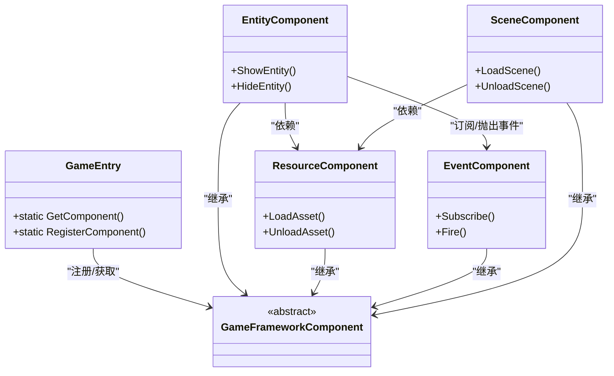
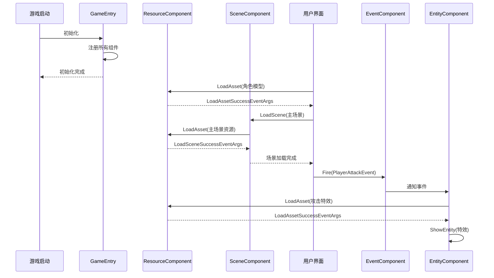

# 项目概述

<cite>
**Referenced Files in This Document**   
- [README.md](file://README.md)
- [GameEntry.cs](file://Scripts/Runtime/Base/GameEntry.cs)
- [EntityComponent.cs](file://Scripts/Runtime/Entity/EntityComponent.cs)
- [ResourceComponent.cs](file://Scripts/Runtime/Resource/ResourceComponent.cs)
- [EventComponent.cs](file://Scripts/Runtime/Event/EventComponent.cs)
- [SceneComponent.cs](file://Scripts/Runtime/Scene/SceneComponent.cs)
</cite>

## 目录
1. [核心目的与设计目标](#核心目的与设计目标)
2. [目标受众](#目标受众)
3. [模块化架构与协同机制](#模块化架构与协同机制)
4. [高层级数据流示例](#高层级数据流示例)
5. [前提知识指导](#前提知识指导)
6. [框架设计哲学深入解读](#框架设计哲学深入解读)

## 核心目的与设计目标

UnityGameFramework 是一个基于 Unity 引擎的综合性游戏开发框架，其核心目的在于通过模块化封装，为游戏开发过程提供一套标准化、高效率的解决方案。该框架旨在解决中大型项目开发中常见的代码混乱、流程不规范和性能瓶颈等问题，从而显著提升开发速度并保障最终产品的质量。

框架的设计目标主要体现在三个方面：**提升开发效率**、**规范开发流程**和**保障产品质量**。通过将游戏开发中常用的19个功能模块（如实体、资源、事件等）进行高度封装，开发者可以避免重复造轮子，直接调用经过验证的稳定接口，极大地缩短了开发周期。同时，框架强制推行了一套清晰的架构规范，例如通过 `GameEntry` 统一管理所有 `GameFrameworkComponent` 的注册与获取，确保了代码结构的统一性和可维护性。此外，框架内置了如对象池、虚拟文件系统等性能优化机制，并通过调试器组件提供实时监控，从底层保障了游戏的运行质量和稳定性。

**Section sources**
- [README.md](file://README.md#L1-L102)
- [GameEntry.cs](file://Scripts/Runtime/Base/GameEntry.cs#L1-L147)

## 目标受众

UnityGameFramework 的设计充分考虑了不同层次开发团队的需求，其目标受众广泛，主要包括以下三类开发者：

1.  **中大型游戏开发团队**：对于拥有复杂项目结构和多人协作需求的团队，该框架提供的标准化架构和模块化设计是理想的解决方案。它能够有效解耦各个游戏系统，减少团队成员间的代码冲突，确保项目在快速迭代中依然保持良好的可维护性。
2.  **需要标准化架构的独立开发者**：独立开发者往往需要兼顾策划、美术和程序等多重角色。UnityGameFramework 为他们提供了一套“开箱即用”的成熟架构，使其能够将精力集中在核心玩法和内容创作上，而无需花费大量时间搭建和调试底层框架。
3.  **希望降低技术门槛的新手开发者**：对于刚接触 Unity 的新手，该框架是一个绝佳的学习和实践平台。通过使用框架提供的清晰接口和文档，新手可以快速理解游戏开发的核心概念（如实体、资源管理、事件系统），并在实践中掌握最佳实践，从而平稳地过渡到更复杂的项目开发。

**Section sources**
- [README.md](file://README.md#L1-L102)

## 模块化架构与协同机制

UnityGameFramework 采用组件化设计，实现了高内聚、低耦合的架构。框架的核心是 `GameFrameworkComponent` 基类，所有19个内置模块（如 `EntityComponent`、`ResourceComponent`、`EventComponent` 等）都继承自此类。这些组件在运行时通过 `GameEntry` 进行统一注册和管理。

各模块间的协同工作机制如下：当游戏启动时，`GameEntry` 会自动发现并注册场景中所有 `GameFrameworkComponent` 的实例。每个组件在 `Awake` 阶段通过 `GameEntry.RegisterComponent(this)` 完成注册。之后，开发者可以通过 `GameEntry.GetComponent<T>()` 静态方法，以类型安全的方式获取任何已注册的组件引用，从而实现模块间的通信。

例如，`EntityComponent` 在初始化时会向 `EventComponent` 订阅 `ShowEntitySuccess` 等事件，当实体成功加载时，`EntityComponent` 会通过 `EventComponent.Fire()` 抛出事件，通知所有监听者。这种基于事件的通信模式，使得模块之间无需直接持有对方的引用，极大地降低了耦合度。

**Diagram sources**
- [GameEntry.cs](file://Scripts/Runtime/Base/GameEntry.cs#L1-L147)
- [EntityComponent.cs](file://Scripts/Runtime/Entity/EntityComponent.cs#L1-L799)
- [ResourceComponent.cs](file://Scripts/Runtime/Resource/ResourceComponent.cs#L1-L799)
- [EventComponent.cs](file://Scripts/Runtime/Event/EventComponent.cs#L1-L135)
- [SceneComponent.cs](file://Scripts/Runtime/Scene/SceneComponent.cs#L1-L477)

**Section sources**
- [README.md](file://README.md#L1-L102)
- [GameEntry.cs](file://Scripts/Runtime/Base/GameEntry.cs#L1-L147)

## 高层级数据流示例

以下是一个从项目初始化到运行时交互的典型高层级数据流示例：

1.  **游戏启动**：游戏进程启动，Unity 加载包含 `GameFrameworkComponent` 的主场景。
2.  **GameEntry 初始化**：`GameEntry` 类作为入口点，其静态构造函数准备就绪。
3.  **组件注册**：所有 `GameFrameworkComponent` 子类（如 `EntityComponent`, `ResourceComponent`）在 `Awake` 阶段被 `GameEntry` 自动注册。
4.  **资源加载**：游戏逻辑调用 `ResourceComponent.LoadAsset()` 异步加载所需资源（如角色模型、UI 界面）。加载完成后，会触发 `LoadAssetSuccessEventArgs` 事件。
5.  **场景切换**：通过 `SceneComponent.LoadScene()` 加载新的游戏场景。该操作内部会调用 `ResourceComponent` 来加载场景资源。
6.  **用户交互触发事件**：用户点击界面上的按钮，UI 逻辑调用 `EventComponent.Fire()` 抛出一个自定义事件（如 `PlayerAttackEvent`）。
7.  **实体响应**：`EntityComponent` 中注册了对 `PlayerAttackEvent` 的监听。当事件被抛出时，`EntityComponent` 接收到通知，并调用 `ShowEntity()` 方法来实例化一个攻击特效实体。

此流程清晰地展示了框架如何通过异步资源加载、事件驱动和实体管理等机制，协调各个模块完成复杂的游戏逻辑。

**Diagram sources**
- [GameEntry.cs](file://Scripts/Runtime/Base/GameEntry.cs#L1-L147)
- [ResourceComponent.cs](file://Scripts/Runtime/Resource/ResourceComponent.cs#L1-L799)
- [SceneComponent.cs](file://Scripts/Runtime/Scene/SceneComponent.cs#L1-L477)
- [EventComponent.cs](file://Scripts/Runtime/Event/EventComponent.cs#L1-L135)
- [EntityComponent.cs](file://Scripts/Runtime/Entity/EntityComponent.cs#L1-L799)

## 前提知识指导

为了有效使用 UnityGameFramework，开发者需要具备以下前提知识：

*   **Unity 基础**：熟悉 Unity 编辑器的基本操作，包括场景管理、GameObject 与 Component 的概念、Prefab 的使用以及 Inspector 面板的配置。
*   **C# 编程**：掌握 C# 语言的核心语法，包括类、对象、继承、接口、泛型、委托和事件等面向对象编程特性。框架大量使用了这些特性，例如 `GameEntry.GetComponent<T>()` 就是一个泛型方法。
*   **面向对象设计模式**：理解常见的设计模式，特别是**观察者模式**（事件系统）、**单例模式**（`GameEntry` 的静态访问）和**工厂模式**（实体的创建与管理）。这些模式是理解框架内部工作原理的关键。

**Section sources**
- [README.md](file://README.md#L1-L102)

## 框架设计哲学深入解读

### 为何强制异步资源加载

UnityGameFramework 强制使用异步资源加载，其设计哲学源于对**玩家体验**的极致追求。同步加载（如 `Resources.Load()`）会阻塞主线程，导致游戏画面卡顿甚至无响应，严重影响用户体验。框架通过 `ResourceComponent.LoadAsset()` 提供的异步接口，将资源加载操作放入后台线程或分帧处理，确保主线程始终流畅运行。这不仅避免了卡顿，还允许开发者在加载过程中显示进度条，提供更友好的等待反馈。

### 组件注册机制的实现原理

组件注册机制是框架实现统一管理的核心。其原理基于 `GameEntry` 内部维护的一个 `LinkedList<GameFrameworkComponent>` 链表。当任何 `GameFrameworkComponent` 的子类在 `Awake` 阶段被创建时，其基类的 `Awake` 方法会自动调用 `GameEntry.RegisterComponent(this)`，将自身实例添加到该链表中。`GameEntry.GetComponent<T>()` 方法则遍历此链表，通过类型匹配来查找并返回对应的组件实例。这种设计确保了所有核心组件都能被集中管理，且获取过程高效、类型安全。

**Section sources**
- [GameEntry.cs](file://Scripts/Runtime/Base/GameEntry.cs#L1-L147)
- [ResourceComponent.cs](file://Scripts/Runtime/Resource/ResourceComponent.cs#L1-L799)